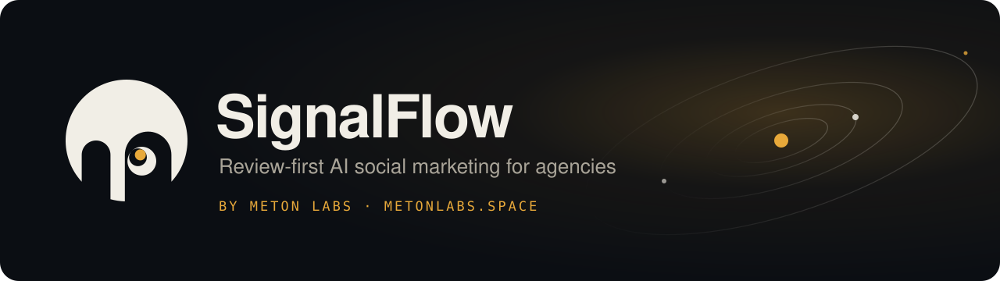
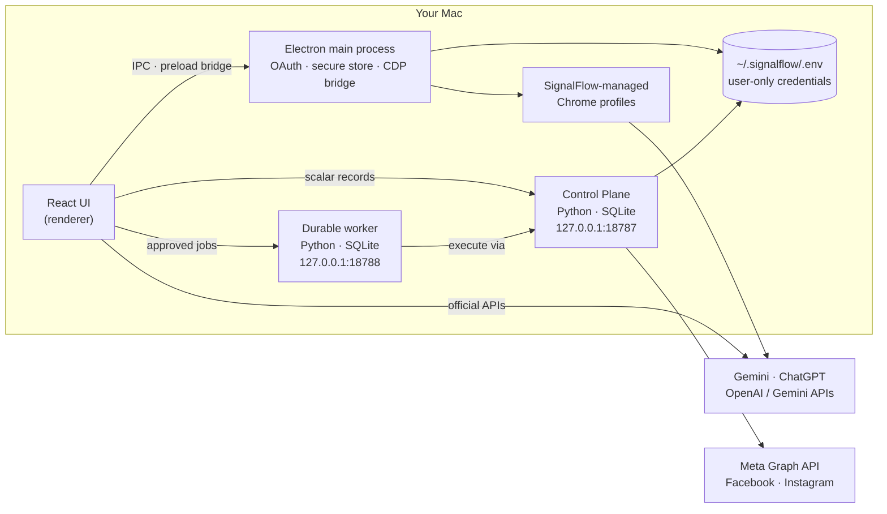

<p align="center">
  
</p>

<p align="center">
  <b>Plan, draft, review and publish social content for many brands — with a human approving every post.</b>
</p>

<p align="center">
  
  
  
  
  
</p>

<p align="center">
  <a href="https://metonlabs.space">Website</a> ·
  <a href="#quick-start">Quick start</a> ·
  <a href="#architecture">Architecture</a> ·
  <a href="#security-model">Security</a> ·
  <a href="#about-this-repository">About this repository</a>
</p>

---

## What is SignalFlow?

SignalFlow is a desktop app for marketing agencies that run social channels for several clients. It turns each brand's identity and content strategy into a daily plan, drafts posts with the AI provider you choose, and publishes through official platform APIs — **but only after a person approves each post**.

- **Agency-shaped.** Client → Brand → versioned Brand Identity → one binding per real social account. Brands never leak into each other's drafts.
- **Review-first.** Automation creates drafts that land in a review inbox as `Needs review`. Nothing is published without approval and a publishing preflight.
- **Bring your own AI.** Use the Gemini or ChatGPT web subscription you already pay for, the official OpenAI or Gemini API, or write manually.
- **Local by design.** Your data and credentials stay on your Mac. Social-platform tokens never reach the interface.

## Features

| Area | What you get |
|---|---|
| **Brands & clients** | Workspaces per client, Brand Kit with readiness warnings, versioned brand identity and content strategy |
| **Automation Planner** | Per-platform posts per day, image/video mix and an exact `HH:mm` time for every post; daily scheduler while the app is open |
| **AI drafting** | Gemini Pro and ChatGPT Plus through isolated SignalFlow-managed Chrome profiles, official OpenAI / Gemini APIs, or manual assist |
| **Content studio** | Structured content contract per post: topic, pillar, objective, caption, CTA, hashtags and quality checks |
| **Media library** | Register provider-reachable HTTPS media (including public Google Drive links) with checksum metadata |
| **Review & approval** | Review inbox, approval lock, media preflight, idempotency keys, retry state and manual publish-package export |
| **Publishing** | Facebook Pages (text and image) through the Meta Graph API; Instagram image/Reel adapter |
| **Closed-app worker** | Optional durable worker that publishes already-approved Facebook Page jobs while the window is closed |
| **Knowledge & analytics** | Full-text Knowledge search, research/trend evidence, content recipes and append-only analytics |

## Status

SignalFlow is in **early access**. We call a capability live only after it has worked end to end on a real account.

| Capability | Status |
|---|---|
| Facebook Page publishing (text, image) via Meta Graph API | 🟢 Live |
| Client and brand workspaces, Automation Planner, review inbox | 🟢 Live |
| Gemini Pro subscription drafting | 🟢 Live |
| macOS desktop app | 🟢 Live |
| ChatGPT Plus subscription and OpenAI API drafting | 🟡 In testing |
| Instagram images and Reels | 🟡 In testing |
| Background publishing while the app is closed | 🟡 In testing |
| Google Drive media hosting | 🟡 In testing |
| Claude as a drafting model | ⚪ Planned |
| TikTok and YouTube, after their official app reviews | ⚪ Planned |
| Windows desktop app | ⚪ Planned |

*Status as of October 2026.*

## Architecture



- **Renderer** — React 19 + TypeScript. Platform-neutral domain, planner and queue logic in `src/lib`.
- **Electron main** — owns OAuth, the credential file, Meta discovery and the managed Chrome sessions. Talks to the renderer over a narrow preload bridge.
- **Control Plane** — the SQLite authority for clients, brands, identities, bindings, content runs, publications, media, analytics and audit. It rejects token-, cookie- and key-shaped fields before saving anything.
- **Durable worker** — job queue with unique idempotency keys, atomic claims, retries and safe stop/recover. It never receives provider tokens; it asks the Control Plane to execute.

The packaged app starts and supervises both Python services automatically. See [`docs/control-plane.md`](docs/control-plane.md) and [`docs/local-worker-runtime.md`](docs/local-worker-runtime.md).

## Quick start

**Requirements:** macOS, Node.js with `pnpm`, Python 3, and Google Chrome or Microsoft Edge.

```bash
# 1. Install dependencies
pnpm install

# 2. Configure the local environment
cp .env.example .env.local        # fill in your own Meta app values; never commit it

# 3. Run the UI in the browser (no desktop features)
pnpm dev

# 4. Run the desktop app
pnpm build
pnpm electron
```

Package a macOS app:

```bash
pnpm build:electron
```

Run the closed-app worker on its own (development or an always-on machine):

```bash
pnpm worker:local
```

### Connect an AI provider

1. Open **Settings → AI Providers**.
2. Pick a subscription route (Gemini Pro or ChatGPT Plus) and sign in once in the SignalFlow-managed Chrome window, or add an official API key.
3. Press **Test subscription** — it sends one JSON smoke request and creates nothing.

### Connect a Facebook Page

1. In **Settings → Meta Development**, enter your Meta app details.
2. Use **Channels → Connect via OAuth**. SignalFlow captures `https://localhost/oauth/callback` inside its own Chrome profile and exchanges the code in the main process.
3. Run **Discover Page + Instagram** and bind the Page to a brand.

## Testing

| Suite | Command |
|---|---|
| Frontend, domain and desktop unit tests (Vitest) | `pnpm test` |
| Type check + production build | `pnpm build` |
| Desktop native tests (Node test runner) | `node --test desktop/*.node.cjs` |
| Backend tests (Python) | `uv run --with fastapi --with httpx --with pydantic --with uvicorn python -m unittest discover -s backend -p 'test*.py'` |

The backend command uses a throwaway `uv` environment and adds nothing to the app's dependencies.

## Security model

- **Credentials live in one user-only file**, `~/.signalflow/.env` by default (override with `SIGNALFLOW_ENV_FILE`).
- **Platform tokens stay out of the interface.** You can type a Meta App Secret or token into Settings, but the interface only ever reads back whether one is set; Page tokens are used by the Electron main process and the Control Plane. Official AI API keys are read from the same file when you choose an API route.
- **No cookie or password extraction.** Subscription routes drive a visible, app-owned Chrome profile through local CDP. SignalFlow never reads your normal Chrome profile.
- **Tokens never enter queues or the database.** Worker jobs carry approved metadata only; the Control Plane refuses secret-shaped fields.
- **Loopback only.** The Control Plane and worker listen on `127.0.0.1`. Worker forwarding fails closed unless both services share `SIGNALFLOW_WORKER_AUTH_TOKEN`.
- **Humans approve every post.** Automation creates drafts; approval, preflight and idempotency guard every publish.

Found a security issue? Email **ceo@metonlabs.space**.

## Project layout

```text
backend/          Python Control Plane, durable worker, SQLite store and tests
browser-engine/   Protocol for the managed-browser bridge
desktop/          Electron main process, preload, OAuth, secure store, CDP bridges
docs/             Design notes and runbooks
scripts/          Electron staging, packaging and local worker launcher
src/              React UI and platform-neutral domain logic (src/lib)
src-tauri/        Earlier Tauri shell (not used by the Electron build)
```

## Documentation

- [Control Plane](docs/control-plane.md) — services, routes and the agency state authority
- [Local worker runtime](docs/local-worker-runtime.md)
- [Google Drive media hosting](docs/google-drive-media-hosting.md)
- [Portability boundary](docs/portability-boundary.md)
- [Knowledge retrieval evaluation](docs/signalflow-knowledge-retrieval-eval.md)

## About this repository

This is the public snapshot of the SignalFlow source code, published by Meton Labs for review.

- **Sanitized.** Client data, account identifiers, internal QC evidence and run logs were removed. Brands, people and IDs in the sample data and tests (such as *Mile Mark Money* and *Bellamy Baby*) are fictional.
- **Fresh history.** This repository starts from a clean snapshot; development history is kept privately.
- **Encrypted modules.** The managed-browser automation modules (`desktop/account-browser.cjs`, `desktop/chrome-browser.cjs`, `desktop/drive-media.cjs` and their tests) are encrypted with [git-crypt](https://github.com/AGWA/git-crypt). The rest of the code is readable, but the desktop app does not build or run without the key.
- **Not open source.** The code is published so reviewers and partners can read it. No license is granted to copy, modify or redistribute it. For any other use, email **ceo@metonlabs.space**.

---

<p align="center">
  Built by <a href="https://metonlabs.space"><b>Meton Labs</b></a> · Vietnam<br>
  <sub>© 2026 Meton Labs. All rights reserved. Source available for review only. Platform names belong to their owners; Meton Labs is not affiliated with Meta, Google, OpenAI or Anthropic.</sub>
</p>
